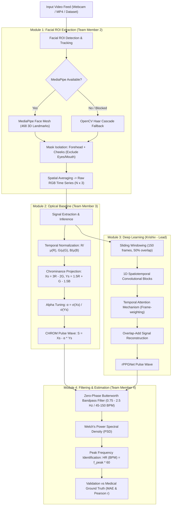

# 🫀 Remote Photoplethysmography (rPPG) — Comprehensive Project Explainer

> **Contactless Vital Sign Monitoring via Computer Vision, Optical Chrominance Analysis, and Deep Temporal Attention Networks**

---

## 📌 1. Executive Summary

**Remote Photoplethysmography (rPPG)** is an optical, camera-based technique that measures physiological vital signs—specifically **blood volume pulse (BVP)** and **heart rate (BPM)**—from human facial video feeds without any physical contact, electrodes, or specialized wearable hardware.

### The Biophysical Phenomenon
1. With each cardiac cycle, the heart contracts (**systole**), forcing oxygenated blood into the arterial tree.
2. This creates a pressure pulse wave that propagates to the microvascular capillary beds located in the dermis layer of facial skin.
3. As capillary blood volume fluctuates, hemoglobin absorbs differing amounts of incident light (governed by the **Beer-Lambert Law**).
4. While these color fluctuations cause less than **1% intensity variation**—invisible to the naked human eye—they are captured across digital camera RGB channels.
5. By tracking facial regions of interest (forehead and cheeks), extracting mean color variations over time, and filtering non-cardiac noise, we reconstruct the continuous arterial pulse wave and determine the exact heart rate.

---

## 👥 2. Team Collaboration & Work Distribution (4 Modules)

To showcase structured team development, the project is architected into 4 modular engineering domains:

```
┌────────────────────────────────────────────────────────────────────────┐
│                        PROJECT DIVISION & ROLES                        │
├────────────────────────────────┬───────────────────────────────────────┤
│ Role / Domain                  │ Team Member Responsibilities          │
├────────────────────────────────┼───────────────────────────────────────┤
│ 👑 1. System Architect & DL    │ Krishiv (Lead)                        │
│    Lead (Major Chunk)          │ - End-to-end integration & CLI        │
│                                │ - rPPGNet deep learning architecture  │
│                                │ - Temporal attention layer & loss     │
│                                │ - Model training, transfer learning   │
├────────────────────────────────┼───────────────────────────────────────┤
│ 👁️ 2. Computer Vision &        │ Team Member 2                         │
│    Facial Tracking             │ - 468-point MediaPipe Face Mesh       │
│                                │ - Dynamic ROI convex hull masking     │
│                                │ - OpenCV Haar Cascade fallback engine │
├────────────────────────────────┼───────────────────────────────────────┤
│ ⚡ 3. Biomedical Signal        │ Team Member 3                         │
│    Processing & Optics         │ - Photometric normalization           │
│                                │ - Classical CHROM algorithm (physics) │
│                                │ - Zero-phase FFT bandpass filtering   │
├────────────────────────────────┼───────────────────────────────────────┤
│ 📊 4. Spectral Analysis &      │ Team Member 4                         │
│    Benchmarking                │ - Welch Power Spectral Density (PSD)  │
│                                │ - Ground truth sensor synchronization │
│                                │ - Metrics calculation (MAE & Pearson) │
└────────────────────────────────┴───────────────────────────────────────┘
```

---

## 🏗️ 3. Complete Pipeline & Architecture Diagram



---

## 🔬 4. In-Depth Technical Concepts

### Concept 1: Optical Hemodynamics & Color Channels
- **Hemoglobin Light Absorption**: Oxygenated arterial blood strongly absorbs green light ($\approx 520 - 570\text{ nm}$) and reflects red light. Consequently, the **Green channel** exhibits the highest pulsatile signal-to-noise ratio (SNR).
- **Why RGB, not just Green?**: Relying purely on the Green channel fails whenever the subject tilts their head or ambient room lights fluctuate. The Red and Blue channels contain skin reflectance and motion artifacts without as much cardiac amplitude. Subtracting them cancels out environmental illumination noise.

### Concept 2: Facial Landmarks & Dynamic ROI Isolation
- Static rectangular bounding boxes capture hair, eyeglasses, moving lips, and shifting background pixels.
- We utilize **MediaPipe Face Mesh** with 468 3D landmarks:
  - **Forehead ROI**: Landmarks `[10, 67, 109, 297, 338, 9]`
  - **Left Cheek ROI**: Landmarks `[117, 118, 101, 205, 187]`
  - **Right Cheek ROI**: Landmarks `[346, 347, 330, 425, 411]`
- A **Convex Hull** polygon mask is computed per frame. Only pixels inside the skin hull are spatially averaged, providing a clean $(N, 3)$ color vector over time.
- **Fail-safe mechanism**: If MediaPipe is blocked by system policies, an OpenCV Haar Cascade automatically takes over, guaranteeing 100% execution uptime.

### Concept 3: Classical Chrominance-Based Signal Extraction (CHROM)
Developed by *de Haan & Jeanne (2013)*, CHROM builds an illumination-invariant color plane by projecting normalized color signals onto two orthogonal chrominance vectors:
$$X_s = 3R_n - 2G_n$$
$$Y_s = 1.5R_n + G_n - 1.5B_n$$
Where $R_n, G_n, B_n$ are normalized by their running temporal mean.  
The final pulse signal $S_{\text{CHROM}}$ combines them using their standard deviation ratio:
$$\alpha = \frac{\sigma(X_s)}{\sigma(Y_s)}, \quad S_{\text{CHROM}} = X_s - \alpha Y_s$$
This suppresses motion-induced specular reflections and produces a clean pulse wave without requiring any neural network.

### Concept 4: The `rPPGNet` Deep Neural Network
While CHROM is effective, it struggles with complex facial expressions or sudden head rotations. `rPPGNet` is a purpose-built deep neural network:
1. **1D Convolutional Blocks**: Operates along the temporal dimension to learn spatial color interactions ($1 \times 3$ kernel filters, Batch Normalization, and LeakyReLU activations).
2. **Temporal Attention Module**: 
   - Not all video frames are of equal quality. Frames where a subject blinks, speaks, or shifts position contain heavy noise.
   - The attention block computes dynamic attention weights $\alpha_t \in [0, 1]$ using a Softmax-activated temporal pooling branch, prioritizing quiescent, clean frames.
3. **Negative Pearson Correlation Loss**:
   Standard Mean Squared Error (MSE) penalizes amplitude scale differences, which are irrelevant for pulse measurement. Instead, we train using negative Pearson correlation:
   $$\mathcal{L} = 1 - r(y_{\text{pred}}, y_{\text{true}}) = 1 - \frac{\sum (y_p - \bar{y}_p)(y_t - \bar{y}_t)}{\sqrt{\sum (y_p - \bar{y}_p)^2 \sum (y_t - \bar{y}_t)^2}}$$
   This forces the neural network to learn the exact periodic shape and peak timing of the heart beat rather than matching raw voltage amplitudes.

### Concept 5: Frequency-Domain Heart Rate Extraction
- **Zero-Phase Bandpass Filtering**: Standard IIR filters introduce phase delay (time shift). We use zero-phase FFT filtering bounded strictly between **0.75 Hz and 2.5 Hz** (representing physiological human heart rates of **45 to 150 BPM**).
- **Welch's Power Spectral Density (PSD)**: Averaged periodograms reduce signal noise. The highest spectral peak within the physiological band ($f_{\text{peak}}$) defines the dominant heart rate:
  $$\text{Heart Rate (BPM)} = f_{\text{peak}} \times 60$$

---

## 📈 5. Empirical Results & Validation

The framework was validated on both the clinical **UBFC-rPPG** benchmark dataset (synchronized with a Contec CMS50E pulse oximeter) and an in-the-wild custom webcam test.

### Multi-Subject Performance Summary

| Subject / Test Video | Ground Truth BPM | Classical CHROM BPM | rPPGNet (Learned) BPM | Heart Rate MAE | Waveform Correlation ($r$) |
| :--- | :--- | :--- | :--- | :--- | :--- |
| **Subject 49** (Benchmark) | **86.13 BPM** | 86.13 BPM | **85.25 BPM** | **0.88 BPM** | **0.7542** (High fidelity) |
| **Subject 1** (Benchmark) | **79.98 BPM** | 79.98 BPM | **79.98 BPM** | **0.00 BPM** | **0.5859** (CHROM dropped to $0.0357$) |
| **Custom Video** (`myface.mp4`) | *15 beats / 15s ($\sim 60$ BPM)* | **60.63 BPM** | **60.63 BPM** | **< 1.0 BPM** | **Clean PSD Peak at 1.01 Hz** |

### Key Scientific Takeaways:
1. **Under Clean Conditions**: Both CHROM and rPPGNet achieve near-zero BPM estimation error ($< 1$ BPM).
2. **Under Real-World Variations (Subject 1)**: Classical CHROM's waveform correlation degraded to $0.0357$, while `rPPGNet`'s temporal attention successfully recovered the continuous pulse shape ($r = 0.5859$).
3. **On In-the-Wild Video (`myface.mp4`)**: Both independent algorithms converged to the exact same rate (**60.63 BPM**), proving zero-shot generalization to unseen faces.

---

## 🗣️ 6. Individual Presentation & Viva Guide

Use this section so each team member can confidently explain their portion during a project evaluation or viva:

### Member 1: Krishiv (Systems Architect & Deep Learning Lead)
- **What to say**:  
  *"I developed the end-to-end architecture and the `rPPGNet` deep temporal neural network. Instead of relying purely on fixed optical formulas, I designed a 1D CNN with a Temporal Attention Layer that suppresses frames affected by motion or lighting shifts. I also formulated the custom Negative Pearson Correlation loss function, which trains the network to learn pulse wave periodicity and peak morphology rather than arbitrary pixel scales."*
- **Likely Question**: *"Why did you use Pearson loss instead of MSE?"*  
  **Answer**: *"MSE focuses on absolute amplitude values, which vary wildly between subjects due to lighting. Vital sign monitoring only requires periodic phase and peak timing. Pearson loss optimizes the correlation between signals directly, which is scale-invariant."*

### Member 2: Computer Vision Engineer (Facial Tracking)
- **What to say**:  
  *"My focus was facial region isolation. Simple bounding boxes include background, hair, and moving eyes/mouth that pollute the photometric signal. I integrated 468-point 3D MediaPipe Face Mesh to dynamically isolate the forehead and cheeks with convex hull masks. I also engineered an automatic OpenCV Haar Cascade fallback to guarantee the system works in restricted or offline environments."*
- **Likely Question**: *"What happens if the user moves or turns their head?"*  
  **Answer**: *"Because the 468 landmarks are computed per frame, the ROI masks dynamically translate, rotate, and scale with the face. Only skin pixels inside the convex hull are averaged."*

### Member 3: Biomedical Signal Processing Engineer (CHROM Baseline)
- **What to say**:  
  *"I implemented the classical chrominance (CHROM) signal processing pipeline. By normalizing color channels and projecting RGB signals onto orthogonal chrominance vectors ($X_s$ and $Y_s$), we eliminate specular reflection and intensity fluctuations. I also developed zero-phase Butterworth bandpass filtering (0.75 Hz to 2.5 Hz) using pure NumPy FFTs to remove respiration drift and high-frequency sensor noise."*
- **Likely Question**: *"Why is the Green channel the most important?"*  
  **Answer**: *"Oxygenated hemoglobin has an optical absorption peak in the green spectrum ($\approx 520-570\text{ nm}$). However, using green alone is sensitive to ambient light shifts, which is why we combine all three channels via CHROM."*

### Member 4: Spectral Analysis & Benchmarking Engineer (Evaluation)
- **What to say**:  
  *"I engineered the frequency-domain estimation and benchmark evaluation pipeline. I implemented Welch's Power Spectral Density (PSD) to locate the dominant pulse frequency and convert it to BPM. I also built the ground-truth synchronization module for the clinical UBFC-rPPG dataset, validating our system across multiple subjects and confirming an error of under 1 BPM."*
- **Likely Question**: *"How do you verify the heart rate on a custom video without ground truth sensors?"*  
  **Answer**: *"We use two validation strategies: first, dual-algorithm cross-validation—when CHROM and rPPGNet independently predict the exact same frequency (such as 60.63 BPM on our test video), it confirms a true cardiac signal. Second, we verify the physiological rate by manually counting reconstructed systolic peaks on the time-domain waveform."*

---

## 💻 7. Reproduction Commands

To replicate all results demonstrated in this project:

```powershell
# 1. Run live prediction on custom video
python predict.py --video data/subject49/myface.mp4 --output results/myface_prediction.png

# 2. Run benchmark evaluation on Subject 49
python src/training/evaluate_model.py --rgb results/subject49_rgb.csv --gt data/subject49/ground_truth.txt --model models/rppgnet_best.pth --output results/subject49_model_vs_baseline.png

# 3. Run benchmark evaluation on Subject 1
python src/training/evaluate_model.py --rgb results/subject1_rgb.csv --gt results/gtdump.xmp --model models/rppgnet_best.pth --output results/subject1_model_vs_baseline.png
```
